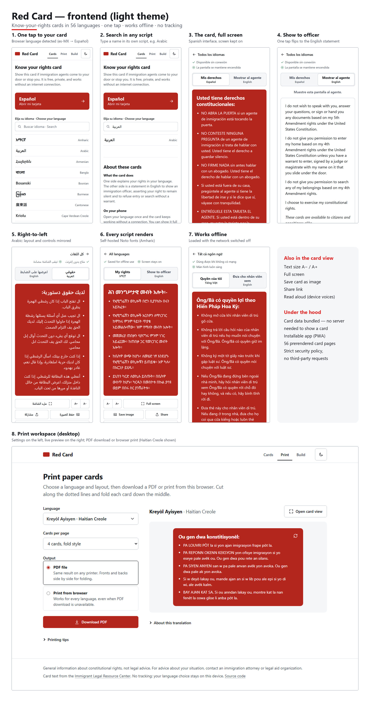

# Red Card Frontend

React app that puts a Know Your Rights red card on someone's phone in their own language, quickly and reliably. It also prints paper cards and helps translators build new cards.

Design goals, in priority order:

1. **A card in one tap.** Home opens with the visitor's remembered or browser language as a large button, followed by every language listed by its own name (endonym).
2. **Works with no server and no connection.** Card content is bundled into the app and precached by a service worker. The backend API is only used for PDF downloads.
3. **Usable in the moment.** The full-screen card view has a large "Show to officer" toggle to the English side. It also keeps the screen on, offers bigger text, saves the card as an image, shares a link, and reads aloud where the device has a voice for the language.
4. **No tracking.** No analytics, no third-party requests (fonts are self-hosted), and a strict Content-Security-Policy. The chosen language is stored only on the device and can be forgotten from the home page.

## Screenshots

Captured from a production build at phone width (390 px) and on desktop. Individual screens are in [`docs/showcase/light`](docs/showcase/light) and [`docs/showcase/dark`](docs/showcase/dark).



[Dark theme version](docs/showcase/showcase-dark.png)

## Related Repository

- Backend API: [redcardapi](https://github.com/pierre-projects/redcardapi)

## Route Map

| Route | Purpose |
|---|---|
| `/` | Language grid, plus a one-tap button for the remembered or browser language. Below it, a short overview. |
| `/card/:code` | Full-screen card view. Accepts aliases such as `es-MX`, `zh` and `fa-AF`, and rewrites them to the canonical code. Prerendered as static HTML at build time. |
| `/redcards`, `/redcards/:code` | Print workspace: preview, browser fold-sheet print, backend PDF. |
| `/builder` | Translation payload builder for translators. Lazy-loaded, so card users never download it. |

## How Card Data Flows

- `data/translations.json` is a snapshot of the backend dataset (`redcardapi/data/Translations_with_sources.json`). Refresh it with `npm run sync:data`, then commit it.
- `src/data/normalize.js` is a pure normalizer shared by the app and the build scripts. `src/data/cards.js` exposes `LANGUAGES`, `getCard(code)` and `BACK_CONTENT`, the English officer-facing text.
- At runtime the app asks the backend only for `/api/languages` (to learn which languages have PDF fonts) and `/api/config` (print layouts). Both run in the background, with timeouts and retries (`fetchWithRetry` in `src/api.js`). If they fail, cards and Browser Print still work, and a non-blocking notice explains that PDF download is unavailable.

## Languages and Fonts

- **Search:** matches the English name, the native name or the code, ignoring accents. For example, `espanol` finds Español and `العربية` finds Arabic (`src/lib/languageMatch.js`).
- **Browser language:** `navigator.languages` is matched with region and script fallbacks and aliases, for example `es-MX→es`, `zh-Hant-HK→zh-tw`, `fa-AF→prs`, `fil→tl`.
- **Text direction:** right-to-left cards set `lang` and `dir` on the card and on `<html>` while shown.
- **Fonts:** Noto fonts for scripts that many phones lack are self-hosted from `@fontsource` packages (`src/fonts.css`): Ethiopic, Myanmar/Karen, Khmer, Lao, Arabic, Hebrew, Indic, Thai, Armenian and Georgian. Each font face has a `unicode-range`, so a device downloads a font only when a card uses that script. The service worker then caches it.
- **Translation sources:** every card has a `source.type`: `official` (ILRC), `machine` (a translation app's output of the English text, with `engine` and `translated_on`) or `community`. Machine translations show a notice above the card, on saved images and printed cards, and in the language lists (`src/lib/translationSource.js`). The wording matches the backend's PDF notice. To add one, see the backend's CONTRIBUTING.md.
- **Interface text:** the card-view controls are translated for es, fr, pt, ht, zh-cn, zh-tw, vi, ar, ru, uk, ko and tl (`src/i18n/messages.js`). Other languages fall back to English. **These strings were drafted without native-speaker review. Have each language checked.**

## Getting Started

```bash
npm install
cp .env.example .env    # set VITE_API_BASE to the backend URL
npm run dev
```

| Script | What it does |
|---|---|
| `npm run dev` | Vite dev server. The service worker and CSP are build-only. |
| `npm run build` | Production build, then `scripts/prerender.mjs` writes `dist/card/<code>/index.html` for every language. |
| `npm run preview` | Serves `dist/`. |
| `npm test` | Vitest unit and app tests (jsdom). |
| `npm run lint` | ESLint. |
| `npm run sync:data` | Copies the backend dataset into `data/translations.json`. |

### Environment

- **`VITE_API_BASE`** is required for production builds; the build fails without it. It is also added to the CSP `connect-src`. To deliberately build a cards-only site without PDF downloads, set `ALLOW_MISSING_API_BASE=1`.
- **`SITE_URL`** is optional. When set, prerendering adds canonical and hreflang links, `sitemap.xml` and `robots.txt`.

## Deployment

The build is a static site that runs on any static host. Host configs are included:

- **Netlify / Cloudflare Pages:** `public/_headers` and `public/_redirects`, copied into `dist/`.
- **Vercel:** `vercel.json`.
- **nginx:** `deploy/nginx.conf`.

The Content-Security-Policy ships as a `<meta>` tag injected at build time (`vite.config.js`), so it applies on every host. Hashed assets are cached for one year, while `sw.js` and HTML are revalidated on every request.

## Project Structure (key files)

```text
data/translations.json          bundled dataset snapshot
scripts/prerender.mjs           per-language static pages, sitemap
scripts/sync-data.mjs           refresh dataset from backend repo
src/App.jsx                     routes and print workspace
src/components/QuickCardAccess  home language grid and one-tap button
src/components/ShowCard.jsx     full-screen card view
src/components/CardPreview.jsx  flip preview in the print workspace
src/data/                       dataset normalization and lookup
src/hooks/                      useLanguages, useWakeLock, useSpeech, useOfflineReady
src/i18n/messages.js            card-view interface strings
src/lib/                        storage (never throws), language matching, card image export
src/features/translationBuilder translation builder
```

## Troubleshooting

- **Unknown language URL:** `/card/<code>` with an unknown code goes back to the home grid with a notice. On `/redcards/<code>`, use "Choose a language".
- **PDF unavailable:** the backend is unreachable, or it has no font for that script (`fontSupported: false`). Browser Print works for every language.
- **Browser print output looks wrong:** disable headers and footers, set scale to 100%, use portrait, and check duplex settings.

## Limitations

- Builder translations aren't submitted to the backend yet.
- Interface strings outside the card view are English only.
- Browser print fidelity depends on the print dialog settings and the printer.

## License

MIT
